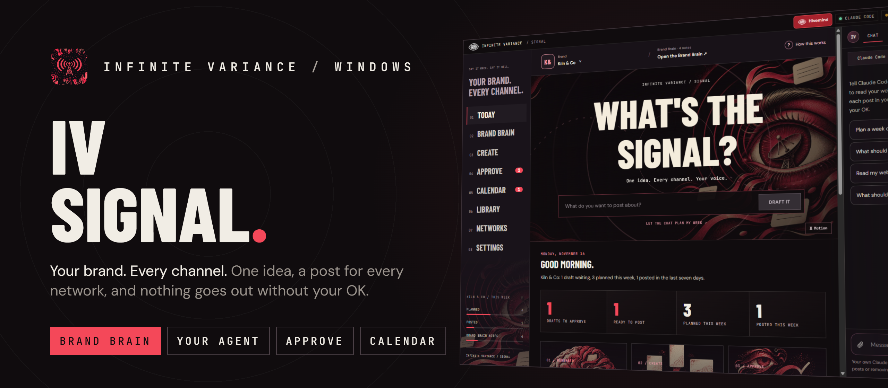
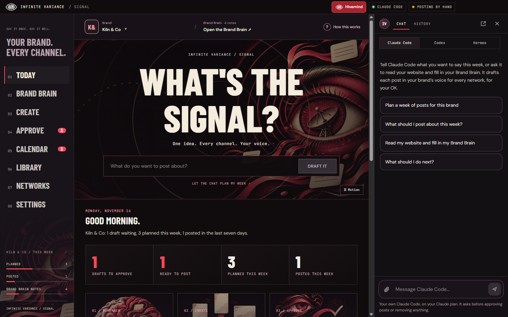
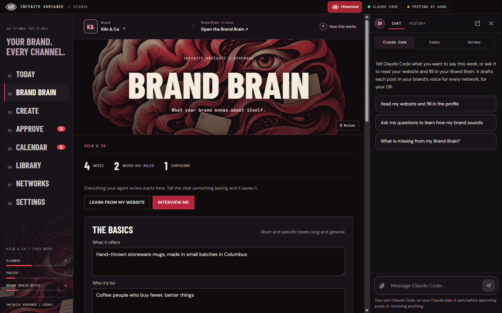
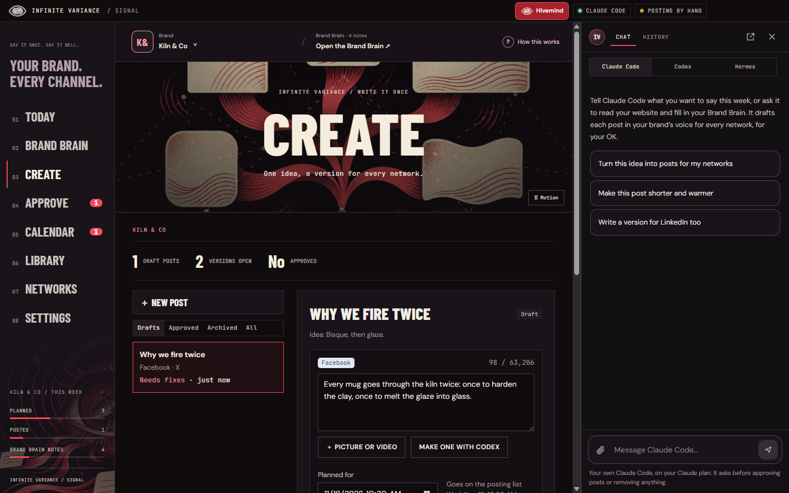
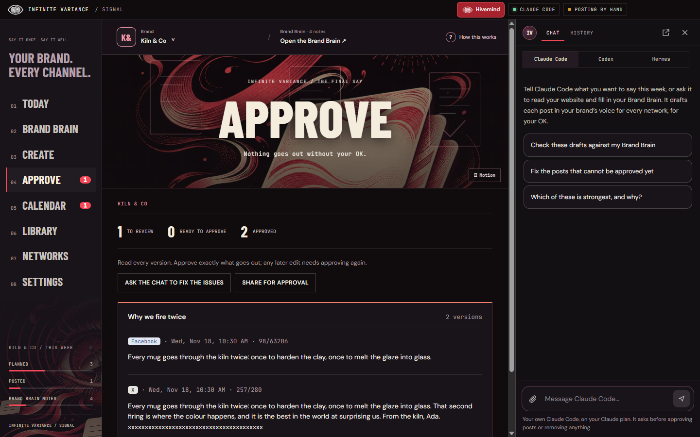
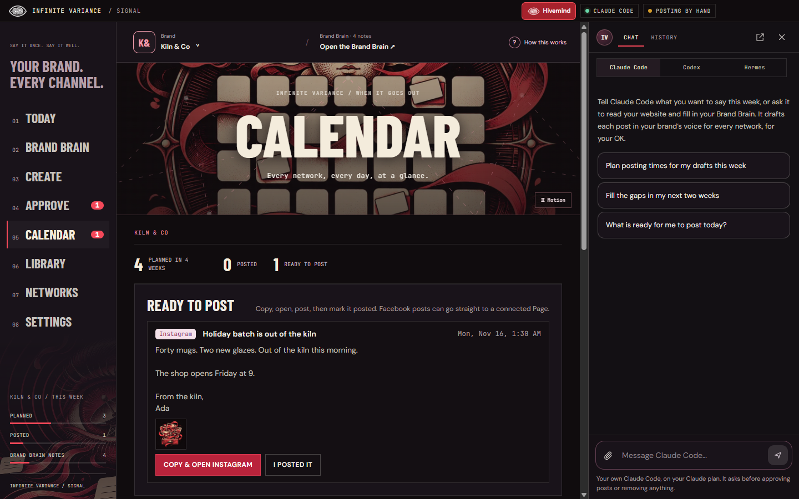
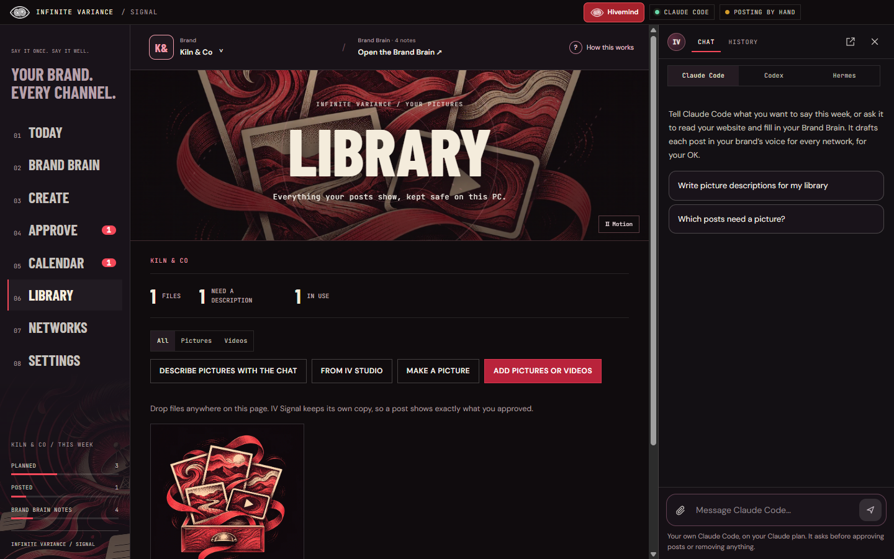
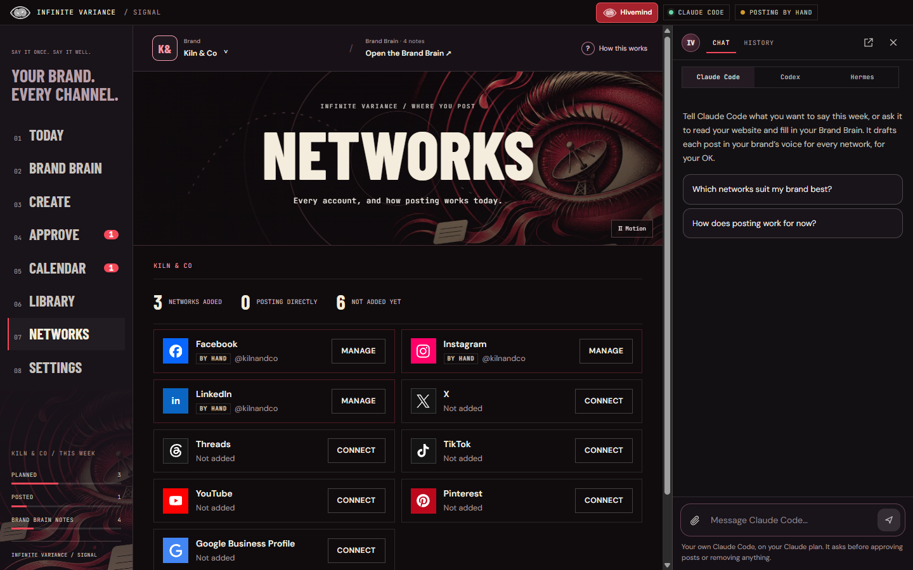

<p align="center">
  
</p>

<p align="center">
  <a href="https://github.com/hollisorg/iv-signal-releases/releases/latest"><b>Download for Windows</b></a>
  &nbsp;·&nbsp;
  <a href="#what-you-need">What you need</a>
  &nbsp;·&nbsp;
  <a href="https://github.com/hollisorg/iv-signal-releases/releases">Release notes</a>
  &nbsp;·&nbsp;
  <a href="https://infinitevariance.ai">Infinite Variance</a>
</p>

# IV Signal

The free Infinite Variance marketing workstation. Keep each brand's voice, offer and rules in a **Brand
Brain**, write one idea as a post for every network, approve exactly what goes out, and plan it on a
calendar. The chat runs on your own **Claude Code, Codex or Hermes**, on your own plan, so IV Signal needs no
API key of its own. Everything stays on your PC.

<p align="center">
  
</p>

## What it does

- **Today.** Say what you want to post about in plain words and your agent drafts it in the brand's voice
  for each network. Below it: what's waiting for approval, what's ready to post and what went out this week.
- **Brand Brain.** What you offer, who it's for and how you sound, plus facts, voice notes, rules, lessons
  and references, one note at a time. A **Never say** list holds the claims your brand never makes. Tell the
  chat something lasting and it saves it here; it can also read your website or interview you to fill it in.
- **Create.** Write the idea once, pick the networks, and each one gets its own version with its own length
  limit. Every version is checked for the network's limit, the picture or video it needs, and your Never say
  list. Edit any of them before approving.
- **Approve.** You have the final say: approve exactly what goes out, and anything changed afterwards needs
  approving again. **Share for approval** saves chosen posts as one page your client can open anywhere.
- **Calendar.** Every planned version by day, with drafts dashed until they're approved. Add the numbers
  for posted versions, ask the chat what worked, and it saves the lesson to the Brand Brain.
- **Library.** Pictures and videos for your posts, with descriptions for people using screen readers.
  **Make a picture** has your own Codex make one in your brand's look, or bring in renders from
  [IV Studio](https://github.com/hollisorg/iv-studio).
- **Networks.** Facebook, Instagram, LinkedIn, X, Threads, TikTok, YouTube, Pinterest and Google Business
  Profile. Most are posted by hand in a click or two: when an approved post's time comes, **Copy & open**
  puts the words on your clipboard and opens the network, then you mark it posted. A **Facebook Page** can
  be connected with a token you make for it, so approved Facebook posts are scheduled on the Page and go out
  on time, even with IV Signal closed.
- **Several brands.** Each brand has its own Brand Brain, posts, calendar and library.
- **Works with your other apps.** Connect IV Signal to Claude Code, Codex or Claude Desktop through MCP and
  they work on the same brands and posts. Through **IV Hivemind** it shares profiles with IV Outreach and
  IV Studio, and picks up handoffs as unapproved drafts.
- **A How this works tour on every page**, and it updates itself.

<table>
  <tr>
    <td width="50%"></td>
    <td width="50%"></td>
  </tr>
  <tr>
    <td align="center"><sub>Brand Brain: everything your agent writes starts here</sub></td>
    <td align="center"><sub>Create: one idea, a version for every network</sub></td>
  </tr>
  <tr>
    <td width="50%"></td>
    <td width="50%"></td>
  </tr>
  <tr>
    <td align="center"><sub>Approve: nothing goes out without your OK</sub></td>
    <td align="center"><sub>Calendar: every network, every day</sub></td>
  </tr>
  <tr>
    <td width="50%"></td>
    <td width="50%"></td>
  </tr>
  <tr>
    <td align="center"><sub>Library: your pictures and videos, kept on this PC</sub></td>
    <td align="center"><sub>Networks: every account, and how posting works today</sub></td>
  </tr>
</table>

## What you need

- **Windows 10 or 11**, 64-bit.
- **Your own agent for the chat:** [Claude Code](https://claude.com/claude-code),
  [Codex](https://openai.com/codex) or Hermes, signed in on your own plan. IV Signal finds the one you have
  (Settings → Your agent). Everything else works without one.
- **Optional:** a Facebook Page access token if you want Facebook posts scheduled for you, and Codex if you
  want **Make a picture**.

## Install

1. Download the newest `IV-Signal-Setup-<version>.exe` from
   [the releases page](https://github.com/hollisorg/iv-signal-releases/releases/latest).
2. Run it. The installer isn't code-signed yet, so Windows may show **"Windows protected your PC"**.
   Click **More info → Run anyway**.
3. Open IV Signal and follow the guided setup: add your first brand, let the chat read your website or
   interview you for the Brand Brain, and add the networks you post to.

IV Signal checks for a new version when it opens and every six hours, downloads it in the background and
installs it when you restart. Your brands, posts and library are kept in `%APPDATA%\IV Signal`.

## Develop

You need Node.js 24 on Windows.

```bash
npm ci
node node_modules/electron/install.js   # npm 11 skips Electron's install script
npm test
npm run dev
npm run dist                             # installer in dist/
```

`npm run mcp` runs the MCP server on its own. `node scripts/ui-check.mjs <folder>` opens the built app on a
throwaway data folder with a fictional brand and screenshots every page; the screenshots here come from it.
How Hivemind handoffs work is in [docs/iv-workspace.md](docs/iv-workspace.md).

## Licence

MIT (see [LICENSE](LICENSE)). The Infinite Variance artwork is Infinite Variance's own and isn't covered by the MIT licence. The screenshots show
Kiln & Co, a fictional brand made up for them.
